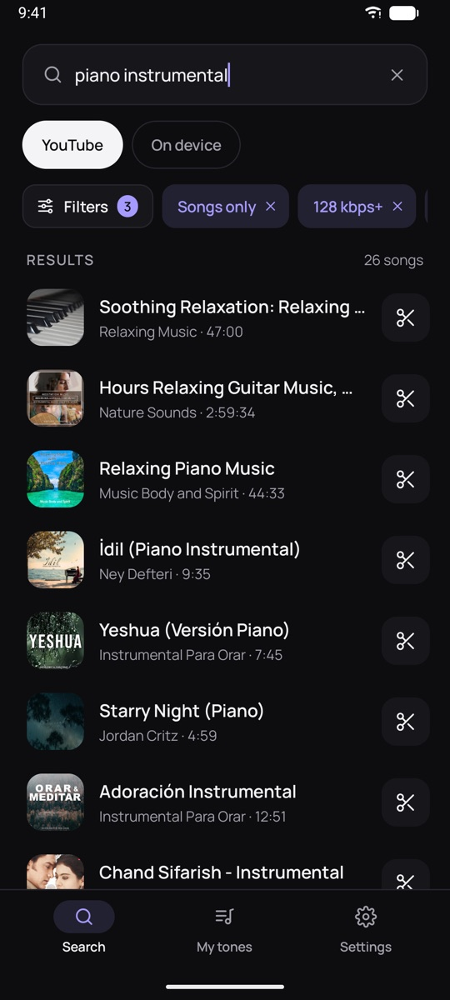
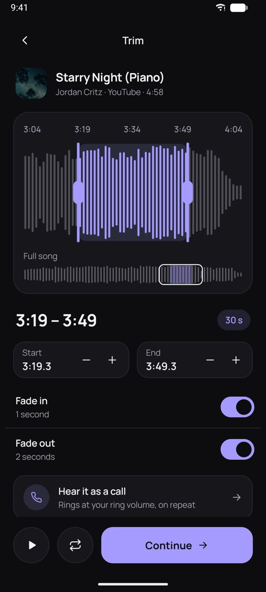
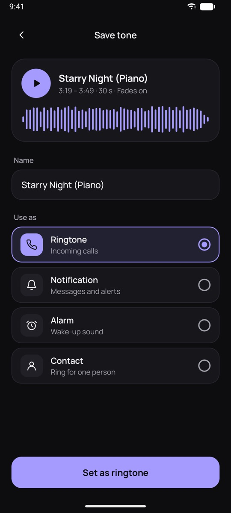
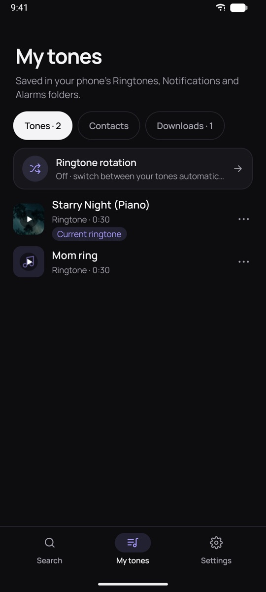
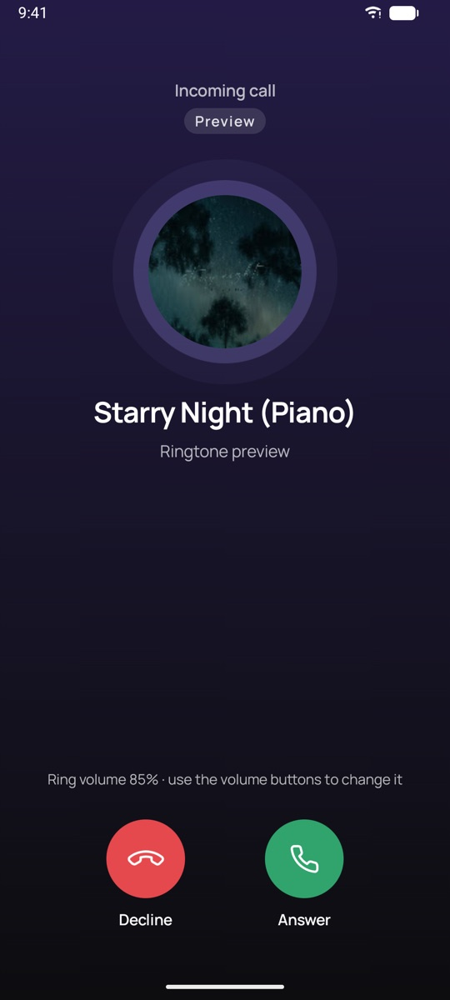

# Tono — ringtone maker

Android app: search YouTube / YouTube Music (or paste a link, or pick a file), trim a clip,
and set it as your ringtone, notification sound or alarm.

> **Personal project.** I built Tono for my own use, with [Claude](https://claude.ai). I haven't
> read a single line of the code, so I can't vouch for how it works.
> It's shared as is: I'm not planning to maintain it for others, and I won't be accepting issues
> or pull requests. You're welcome to fork it.

| Search | Trim | Save | My tones | Call preview |
| --- | --- | --- | --- | --- |
|  |  |  |  |  |

## Download

Feel free to use the app: grab the APK from the [latest release](https://github.com/sibiraj-s/tono/releases/latest)
and open it on your phone (Android 10 or newer). Android will ask you to allow installing apps from
your browser or file manager.

## Stack

| Piece | Used for |
| --- | --- |
| Kotlin + Jetpack Compose (Material 3) | UI |
| [NewPipeExtractor](https://github.com/TeamNewPipe/NewPipeExtractor) | YouTube search and audio stream URLs, no API key |
| OkHttp | HTTP for NewPipe + chunked audio download |
| Media3 ExoPlayer | Preview playback |
| Media3 Transformer + custom `AudioProcessor` | Clip, fade in/out, volume leveling, AAC `.m4a` export |
| MediaStore + RingtoneManager | Save to `Ringtones/Tono`, `Notifications/Tono`, `Alarms/Tono` and set the default |
| DataStore | Filters and theme |
| WorkManager | Ringtone rotation |
| GitHub Releases API + FileProvider | In-app update check and install |

## Build it yourself

Open the project in Android Studio (with *Android SDK Platform 37* installed), or run
`./gradlew installDebug` with a phone connected. `./gradlew test` runs the unit tests.

Dependencies are checked against the checksums in `gradle/verification-metadata.xml`. After changing a
version, refresh them with
`./gradlew --write-verification-metadata sha256 :app:assembleRelease :app:assembleDebug :app:testDebugUnitTest`.

Use it for personal tones from music you have the right to use.
